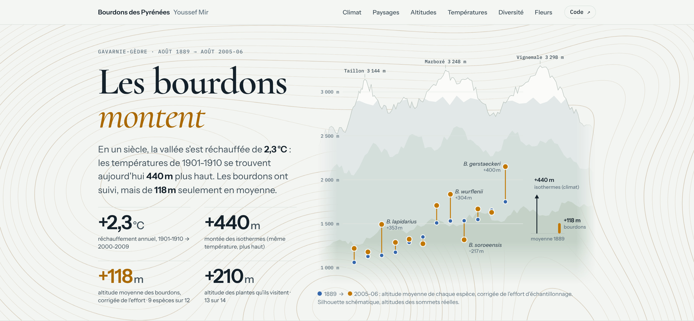
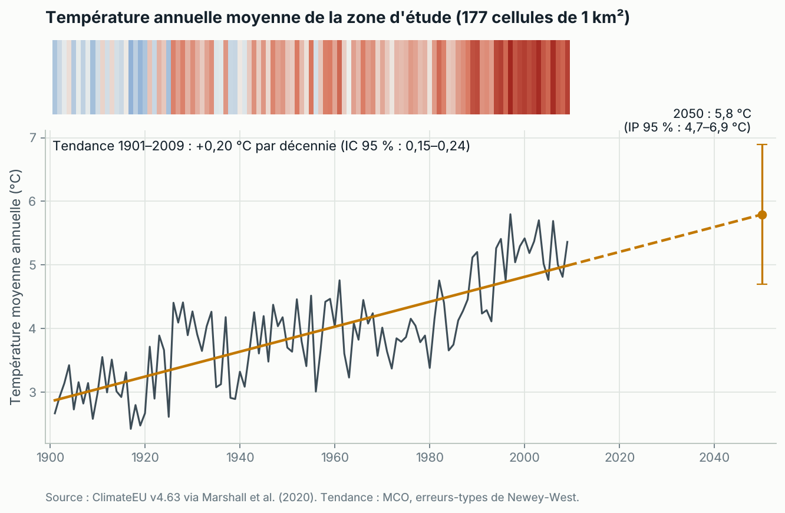
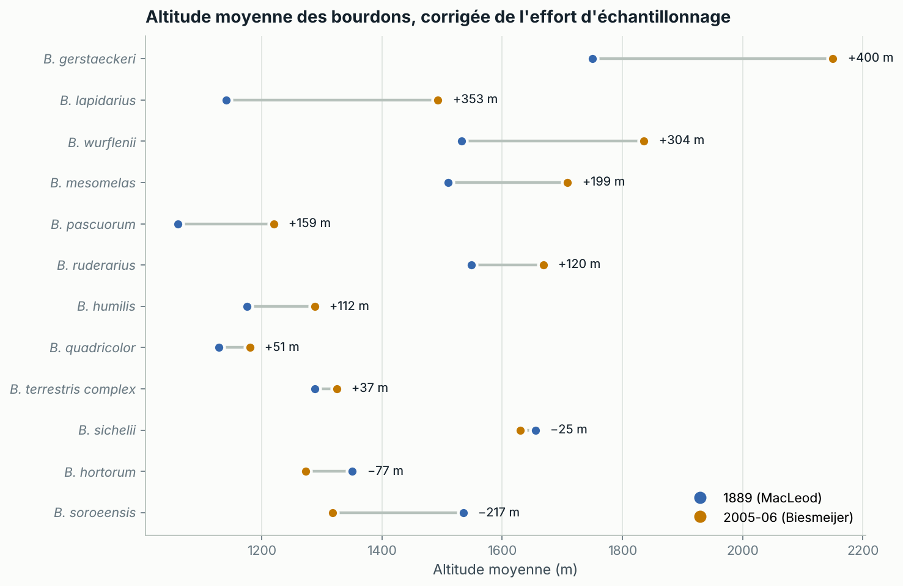
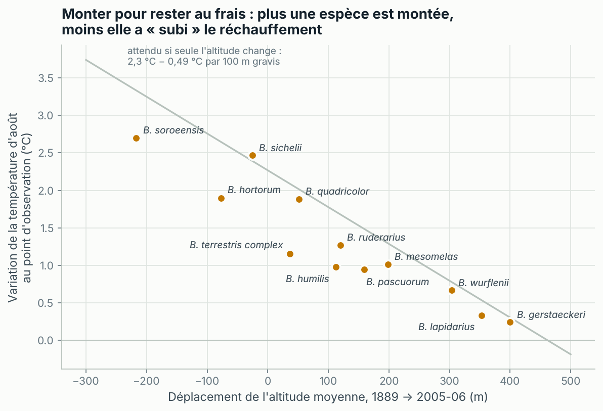

# Les bourdons des Pyrénées face au réchauffement (1889 → 2005)

En 115 ans, la vallée de Gavarnie s'est réchauffée de 2,3 °C et les bourdons butinent en moyenne
**118 m plus haut** qu'en 1889, soit près de quatre fois moins que la montée des isothermes (≈ 440 m).

[](https://youssefmir.github.io/Analysis-of-pollination-in-the-Pyrenees-main/)

**[Voir le site interactif](https://youssefmir.github.io/Analysis-of-pollination-in-the-Pyrenees-main/)** · [Lire le notebook](https://github.com/youssefmir/Analysis-of-pollination-in-the-Pyrenees-main/blob/main/notebooks/bourdons_pyrenees.ipynb) · [Données](#données)

## En bref

- **Climat** : +2,3 °C entre 1901-1910 et 2000-2009 (+0,20 °C par décennie). Une température donnée se trouve aujourd'hui environ 440 m plus haut.
- **Paysages** : entre 1 000 et 1 400 m, la forêt passe de 22 % à 67 % du territoire entre 1910 et 2010, et la prairie de 67 % à 33 %.
- **Bourdons** : +118 m en moyenne une fois l'effort d'échantillonnage corrigé (IC 95 % : 3 à 233 m). 9 espèces sur 12 montent.
- **Fleurs visitées** : +210 m en moyenne. 13 plantes sur 14 sont visitées plus haut.
- **Conséquence** : en août, les bourdons butinent 1,3 °C plus chaud qu'en 1889. C'est significatif pour 8 espèces sur 12.

## Le projet

TP universitaire d'analyse de données (2022-2023, Youssef Mir) construit sur l'article de
Marshall *et al.* (2020). On compare deux inventaires de bourdons de la vallée de Gavarnie-Gèdre
(Hautes-Pyrénées), réalisés à 115 ans d'écart : août 1889 par Julius MacLeod, août 2005-2006 par
l'équipe de Koos Biesmeijer. La question : les bourdons et les fleurs qu'ils pollinisent ont-ils
suivi le réchauffement en montant en altitude ? Le dépôt contient :

- un site interactif (`docs/`) ;
- le notebook commenté, qui répond une à une aux questions de l'énoncé (`notebooks/`) ;
- un package Python testé (`src/bumblebees`).

## Démarrage rapide

Prérequis : Python 3.10 ou plus récent (testé avec Python 3.11). Aucune clé ni téléchargement manuel
n'est nécessaire : les données sont dans `data/raw/`.

```bash
git clone https://github.com/youssefmir/Analysis-of-pollination-in-the-Pyrenees-main.git
cd Analysis-of-pollination-in-the-Pyrenees-main
python -m venv .venv
source .venv/bin/activate        # Windows : .venv\Scripts\activate
pip install -r requirements.txt
pip install -e .
jupyter notebook notebooks/bourdons_pyrenees.ipynb
```

L'installation prend une à deux minutes. Le notebook s'exécute en entier en une dizaine de
secondes, y compris les 1 000 rééchantillonnages.

## Utilisation

- Régénérer les données du site après une modification de l'analyse :
  `python scripts/build_site_data.py`
- Prévisualiser le site : `python -m http.server -d docs 8000`, puis ouvrir http://localhost:8000
- Lancer les tests (après `pip install -r requirements-dev.txt`) : `pytest`
- Réutiliser le code, par exemple pour le déplacement moyen des espèces corrigé de l'effort :

```python
from bumblebees import data, shifts

bees = data.load_bumblebees()                  # 854 observations, toponymes réparés
moved = shifts.resampled_shifts(bees)          # 1 000 rééchantillonnages par tranche de 200 m
print(shifts.mean_shift_test(moved["shift"]))
# {'mean': 117.86, 'ci_low': 3.01, 'ci_high': 232.71, 't': 2.26, 'df': 11, 'p_value': 0.045, 'n_up': 9, 'n': 12}
```

## Résultats



La température annuelle moyenne des 177 cellules de 1 km² augmente de 0,20 °C par décennie, avec
une nette accélération depuis les années 1980. Le prolongement de la tendance donne 5,8 °C en 2050.



Une fois l'effort d'échantillonnage égalisé, 9 espèces sur 12 sont plus haut en 2005-06.
*B. lapidarius* (+353 m) et *B. wurflenii* (+304 m) montent le plus. *B. soroeensis* (−217 m)
élargit son aire vers le bas comme vers le haut.



Plus une espèce est montée, moins la température d'août à laquelle elle butine a augmenté. Les
quatre espèces sans réchauffement significatif sont celles qui sont le plus montées.

## Méthode

1. **Lecture et contrôle des données** : `Grid-ID` numérote les lignes ; les vraies parcelles sont
   177 cellules suivies pendant 109 ans. Les colonnes `Avg_min` et `Avg_max` sont inversées, et trois
   toponymes ont perdu leurs accents. Tout est corrigé à la lecture.
2. **Climat** : moyenne annuelle des cellules, puis droite de tendance par moindres carrés. Les
   intervalles de confiance utilisent les erreurs-types de Newey-West, qui tiennent compte de la
   ressemblance entre années voisines. Le gradient altitudinal entre cellules (−0,52 °C par 100 m)
   convertit le réchauffement en mètres d'altitude.
3. **Occupation du sol** : parts de forêt, prairie et roche par zone et décennie ; test du χ² (écart
   entre deux répartitions) entre 1910 et 2010.
4. **Richesse** : courbes de raréfaction de Hurlbert, qui donnent le nombre d'espèces attendu pour un
   même nombre d'individus, avec l'intervalle de Heck *et al.*
5. **Températures** : test de Kruskal-Wallis par espèce (comparaison de deux distributions sans
   supposer la loi normale), puis correction de Holm pour les 12 tests.
6. **Altitudes** : rééchantillonnage de Chen *et al.* (2011). Dans chaque tranche de 200 m, la
   période la plus échantillonnée est réduite au hasard à l'effectif de l'autre (1 000 tirages).
   Un test t porte ensuite sur les 12 espèces. C'est la méthode de l'article, ce qui permet de
   comparer les résultats.

## Données

| Fichier | Contenu | Source | Licence |
|---|---|---|---|
| `data/raw/Regional_Trend_Temps.csv` | Températures annuelles modélisées, 177 cellules de 1 km², 1901-2009 | Marshall *et al.* (2020), ClimateEU v4.63 | Publiées avec l'article, sans licence explicite : usage pédagogique avec citation |
| `data/raw/Regional_LandUse.csv` | Occupation du sol par décennie, 1910-2010, 198 cellules | Marshall *et al.* (2020), reconstitution HILDA | Idem |
| `data/raw/Bumblebee_data_climate_Marshall_et_al_2020.csv` | 854 observations de bourdons (12 espèces, 83 plantes), 1889 et 2005-06 | Marshall *et al.* (2020) | Idem |

Dictionnaire des colonnes et précisions dans [`data/README.md`](data/README.md). Les fichiers
viennent du dépôt [lmar116/PyreneesBumblebees](https://github.com/lmar116/PyreneesBumblebees).

## Structure du dépôt

```text
.
├── data/
│   ├── raw/                     données brutes de Marshall et al. (2020), non modifiées
│   └── README.md                sources, licences et dictionnaire des colonnes
├── notebooks/
│   └── bourdons_pyrenees.ipynb  énoncé du TP, analyse commentée et conclusions
├── src/bumblebees/              package Python
│   ├── data.py                  lecture, corrections, téléchargement des données brutes
│   ├── climate.py               tendance, gradient altitudinal, occupation du sol
│   ├── community.py             effort d'échantillonnage, raréfaction, diversité
│   ├── shifts.py                déplacements d'altitude, niche thermique, plantes
│   ├── plotting.py              style et figures du notebook
│   └── site.py                  export des résultats pour le site
├── scripts/build_site_data.py   régénère docs/data.js
├── docs/                        site interactif (GitHub Pages)
├── tests/                       tests unitaires (pytest)
├── assets/                      visuel de couverture, figures, illustrations
├── references/                  article de Marshall et al. (2020)
├── requirements.txt             dépendances (versions testées)
├── requirements-dev.txt         outils de test et de qualité
└── pyproject.toml               package, configuration black, ruff et pytest
```

## Limites

- Les deux inventaires n'ont pas le même protocole : 12 lieux-dits en 1889, 213 parcelles de
  15 minutes en 2005-06. Les emplacements exacts de MacLeod sont inconnus.
- Les températures sont modélisées, et non mesurées, et plus incertaines avant 1950. Les
  températures d'août « subies » découlent donc en partie mécaniquement de l'altitude des relevés.
- Le fichier ne garde que les 12 espèces présentes aux deux périodes : impossible de conclure sur
  des espèces perdues ou gagnées.
- L'altitude d'une plante est celle où un bourdon l'a visitée, pas son aire de répartition.
- Climat et fermeture des prairies agissent dans le même sens. Les données ne permettent pas de
  séparer leurs effets.

## Évolutions par rapport à la première version

- La table climatique est relue correctement : 177 cellules et non 19 293 parcelles, colonnes
  minimum et maximum remises dans le bon ordre.
- La tendance est estimée sur la moyenne annuelle avec un intervalle de confiance, et la projection
  2050 avec un intervalle de prédiction.
- L'occupation du sol est exprimée en parts, avec un test du χ² et une interprétation unique (la
  première version se contredisait).
- Les courbes de raréfaction demandées par l'énoncé sont ajoutées.
- Le test de Kruskal-Wallis demandé remplace l'ANOVA paramétrique, avec une correction pour tests
  multiples.
- Les altitudes sont corrigées de l'effort d'échantillonnage, au lieu de boîtes à moustaches
  superposées.
- Les profils de visite des trois plantes principales sont exprimés en parts, avec la comparaison
  des visiteurs (indice de Jaccard).
- Le code est rangé dans un package documenté et testé, le notebook se réexécute de bout en bout et
  les toponymes abîmés sont réparés.
- Le site interactif est ajouté.

## Auteurs et références

- **Youssef Mir** : analyse, code et site, à partir de l'énoncé du TP « Pollinisation de plantes
  sauvages par les bourdons » (repris dans le notebook).
- Marshall L., Perdijk F., Dendoncker N., Kunin W., Roberts S., Biesmeijer J. C. (2020).
  *Bumblebees moving up: shifts in elevation ranges in the Pyrenees over 115 years.*
  Proc. R. Soc. B 287 : 20202201. https://doi.org/10.1098/rspb.2020.2201
- Chen I-C., Hill J. K., Ohlemüller R., Roy D. B., Thomas C. D. (2011). *Rapid range shifts of
  species associated with high levels of climate warming.* Science 333 : 1024-1026.
- Hurlbert S. H. (1971). *The nonconcept of species diversity.* Ecology 52 : 577-586.
- Heck K. L., van Belle G., Simberloff D. (1975). *Explicit calculation of the rarefaction diversity
  measurement.* Ecology 56 : 1459-1461.
